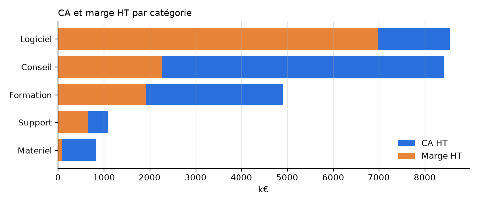
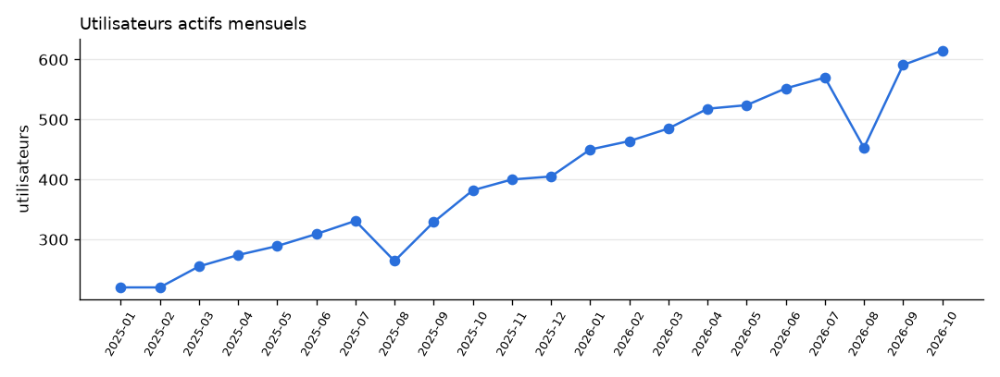
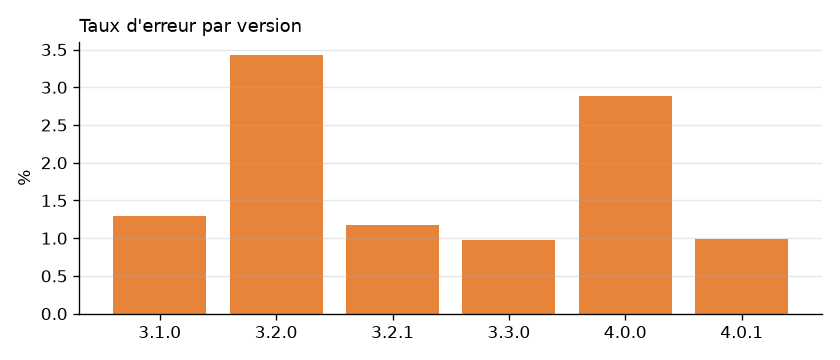

# Rapport d'analyse

Généré le 2026-11-23 23:56 par `scripts/report.py`, exécution `20261123_235628`. Période couverte : 01/01/2025 au 30/10/2026.

> **Données fictives.** Les fichiers sources sont générés par `scripts/generate_realistic_data.py` : les comportements sont réalistes (saisonnalité, croissance, churn, incidents de version) mais aucun chiffre ne décrit une entreprise réelle.

## Synthèse

- 5 668 ventes valides sur 5 757 lignes brutes, soit 23 777 055 € de CA HT et 11 920 580 € de marge HT (taux de marge 50,1 %).
- Meilleur mois : 2026-03 (1 880 590 € HT). Mois le plus faible : 2025-01 (329 464 € HT).
- Catégorie principale : Logiciel (35,9 % du CA HT). Catégorie la plus petite : Materiel (3,5 %).
- 500 clients actifs sur 1 200 (41,7 %), avec un achat dans les 90 jours avant le 30/10/2026.
- 1 077 tickets support, dont 8 non résolus. Délai médian de résolution : 39,5 h.
- Taux d'erreur applicatif le plus élevé : version 3.2.0 (3,43 %). Le plus bas : version 3.3.0 (0,98 %).

## 1. Chiffre d'affaires et marge par mois

| mois | nb_ventes | nb_clients | ca_ht | marge_ht | taux_marge_pct |
|---|---|---|---|---|---|
| 2025-01 | 103 | 77 | 329 464 | 192 324 | 58,4 |
| 2025-02 | 136 | 99 | 614 705 | 295 091 | 48,0 |
| 2025-03 | 161 | 120 | 706 909 | 368 734 | 52,2 |
| 2025-04 | 180 | 127 | 738 718 | 392 468 | 53,1 |
| 2025-05 | 199 | 130 | 912 635 | 463 140 | 50,7 |
| 2025-06 | 217 | 141 | 812 724 | 401 734 | 49,4 |
| 2025-07 | 185 | 136 | 797 692 | 422 182 | 52,9 |
| 2025-08 | 100 | 89 | 451 935 | 247 449 | 54,8 |
| 2025-09 | 237 | 163 | 1 074 802 | 538 940 | 50,1 |
| 2025-10 | 263 | 192 | 1 043 250 | 505 387 | 48,4 |
| 2025-11 | 268 | 194 | 1 050 512 | 538 005 | 51,2 |
| 2025-12 | 336 | 217 | 1 412 732 | 700 451 | 49,6 |
| 2026-01 | 247 | 181 | 1 055 329 | 509 764 | 48,3 |
| 2026-02 | 270 | 199 | 1 145 797 | 599 067 | 52,3 |
| 2026-03 | 414 | 263 | 1 880 590 | 939 064 | 49,9 |
| 2026-04 | 355 | 243 | 1 493 721 | 733 829 | 49,1 |
| 2026-05 | 315 | 232 | 1 395 512 | 668 567 | 47,9 |
| 2026-06 | 396 | 263 | 1 573 063 | 782 223 | 49,7 |
| 2026-07 | 292 | 205 | 1 291 234 | 611 818 | 47,4 |
| 2026-08 | 201 | 157 | 792 700 | 425 720 | 53,7 |
| 2026-09 | 389 | 278 | 1 655 617 | 808 152 | 48,8 |
| 2026-10 | 404 | 292 | 1 547 413 | 776 468 | 50,2 |

_Source : `sql/analyses/01_ca_marge_mensuels.sql`_

## 2. Chiffre d'affaires par catégorie et canal

| categorie | canal | nb_ventes | ca_ht | marge_ht | taux_marge_pct | part_ca_pct |
|---|---|---|---|---|---|---|
| Conseil | telephone | 465 | 3 914 748 | 1 039 034 | 26,5 | 16,5 |
| Conseil | partenaire | 372 | 3 307 185 | 866 763 | 26,2 | 13,9 |
| Logiciel | partenaire | 647 | 3 191 352 | 2 597 695 | 81,4 | 13,4 |
| Logiciel | telephone | 806 | 3 100 608 | 2 532 512 | 81,7 | 13,0 |
| Formation | telephone | 398 | 2 077 274 | 809 832 | 39,0 | 8,7 |
| Logiciel | web | 764 | 1 946 232 | 1 603 066 | 82,4 | 8,2 |
| Formation | partenaire | 289 | 1 647 744 | 638 253 | 38,7 | 6,9 |
| Conseil | web | 178 | 1 110 412 | 328 056 | 29,5 | 4,7 |
| Formation | web | 350 | 1 029 110 | 414 930 | 40,3 | 4,3 |
| Support | telephone | 229 | 413 674 | 250 562 | 60,6 | 1,7 |
| Support | partenaire | 213 | 363 021 | 219 234 | 60,4 | 1,5 |
| Materiel | telephone | 189 | 315 676 | 31 959 | 10,1 | 1,3 |
| Logiciel | magasin | 147 | 301 308 | 250 875 | 83,3 | 1,3 |
| Materiel | partenaire | 165 | 288 589 | 26 985 | 9,4 | 1,2 |
| Support | web | 187 | 271 251 | 165 588 | 61,0 | 1,1 |
| Materiel | web | 129 | 175 648 | 24 152 | 13,8 | 0,7 |
| Formation | magasin | 59 | 153 552 | 64 182 | 41,8 | 0,6 |
| Conseil | magasin | 21 | 94 355 | 29 292 | 31,0 | 0,4 |
| Materiel | magasin | 32 | 42 245 | 6 678 | 15,8 | 0,2 |
| Support | magasin | 28 | 33 070 | 20 931 | 63,3 | 0,1 |

_Source : `sql/analyses/02_ca_par_categorie_canal.sql`_

## 3. Clients actifs par segment

Actif : au moins un achat dans les 90 jours précédant la dernière vente connue. Les doublons probables de clients sont exclus.

| segment | nb_clients | actifs | inactifs | sans_achat | taux_actifs_pct | ca_ht_moyen_par_acheteur |
|---|---|---|---|---|---|---|
| ETI | 230 | 138 | 55 | 37 | 60,0 | 42 971 |
| Grand compte | 77 | 51 | 12 | 14 | 66,2 | 151 708 |
| Inconnu | 2 | 0 | 2 | 0 | 0,0 | 2 605 |
| PME | 536 | 230 | 193 | 113 | 42,9 | 12 032 |
| Particulier | 355 | 81 | 169 | 105 | 22,8 | 3 326 |
| **Total** | 1 200 | 500 | 431 | 269 | 41,7 | 25 539 |

_Source : `sql/analyses/03_clients_actifs_segment.sql`_

## 4. Support : incidents et délai de résolution

Le délai n'est calculé que pour les tickets résolus ou fermés sans anomalie de dates.

| priorite | nb_tickets | non_resolus | avec_delai | delai_median_h | delai_moyen_h | delai_p90_h | satisfaction_moyenne | nb_notes |
|---|---|---|---|---|---|---|---|---|
| critique | 31 | 0 | 31 | 3,4 | 4,5 | 8,4 | 3,88 | 17 |
| haute | 160 | 1 | 159 | 11,0 | 13,9 | 28,7 | 4,16 | 86 |
| normale | 465 | 3 | 459 | 36,0 | 48,3 | 99,5 | 4,12 | 285 |
| basse | 415 | 4 | 408 | 67,3 | 90,7 | 171,6 | 4,08 | 255 |
| non_renseignee | 6 | 0 | 6 | 52,3 | 70,5 | 138,6 | 3,67 | 3 |
| **Total** | 1 077 | 8 | 1 063 | 39,5 | 58,3 | 124,5 | 4,10 | 646 |

_Source : `sql/analyses/04_support_resolution.sql`_

## 5. Usage produit et erreurs

| mois | utilisateurs_actifs | nb_evenements | nb_erreurs | taux_erreur_pct |
|---|---|---|---|---|
| 2025-01 | 220 | 4 988 | 56 | 1,12 |
| 2025-02 | 220 | 4 765 | 67 | 1,41 |
| 2025-03 | 255 | 5 454 | 146 | 2,68 |
| 2025-04 | 274 | 6 348 | 122 | 1,92 |
| 2025-05 | 289 | 6 615 | 80 | 1,21 |
| 2025-06 | 309 | 6 030 | 66 | 1,09 |
| 2025-07 | 331 | 7 568 | 84 | 1,11 |
| 2025-08 | 264 | 3 757 | 48 | 1,28 |
| 2025-09 | 329 | 7 237 | 92 | 1,27 |
| 2025-10 | 382 | 8 820 | 82 | 0,93 |
| 2025-11 | 400 | 8 053 | 69 | 0,86 |
| 2025-12 | 405 | 8 173 | 95 | 1,16 |
| 2026-01 | 450 | 9 583 | 105 | 1,10 |
| 2026-02 | 464 | 9 536 | 111 | 1,16 |
| 2026-03 | 485 | 10 709 | 82 | 0,77 |
| 2026-04 | 518 | 11 097 | 108 | 0,97 |
| 2026-05 | 524 | 10 962 | 112 | 1,02 |
| 2026-06 | 552 | 12 112 | 261 | 2,15 |
| 2026-07 | 570 | 12 684 | 228 | 1,80 |
| 2026-08 | 453 | 6 397 | 83 | 1,30 |
| 2026-09 | 591 | 12 488 | 141 | 1,13 |
| 2026-10 | 615 | 12 657 | 117 | 0,92 |

_Source : `sql/analyses/06_usage_mensuel.sql`_

| app_version | utilisateurs | nb_evenements | nb_erreurs | taux_erreur_pct | duree_requete_mediane_ms |
|---|---|---|---|---|---|
| 3.1.0 | 268 | 12 250 | 158 | 1,29 | 365 |
| 3.2.0 | 262 | 5 454 | 187 | 3,43 | 419 |
| 3.2.1 | 444 | 38 466 | 453 | 1,18 | 378 |
| 3.3.0 | 712 | 79 302 | 781 | 0,98 | 361 |
| 4.0.0 | 580 | 14 512 | 418 | 2,88 | 646 |
| 4.0.1 | 719 | 36 012 | 358 | 0,99 | 313 |
| inconnue | 37 | 37 | 0 | 0,00 | 468 |

_Source : `sql/analyses/05_usage_erreurs_version.sql`_

## 6. Qualité des données

Lignes isolées dans la table `rejets` (non comptées dans les analyses) :

| table | motif | lignes |
|---|---|---|
| raw_evenements | R1 user_id manquant | 186 |
| raw_evenements | R3 timestamp futur | 9 |
| raw_ventes | R1 vente_id en conflit | 12 |
| raw_ventes | R2 date manquante ou invalide | 9 |
| raw_ventes | R3 client inconnu | 15 |
| raw_ventes | R4 produit inconnu | 5 |
| raw_ventes | R5 devise non geree | 3 |
| raw_ventes | R6 quantite hors plage | 4 |
| raw_ventes | R7 montant negatif | 11 |

Lignes gardées mais signalées :

| signal | lignes |
|---|---|
| ventes : montant TTC recalculé (manquant) | 6 |
| clients : doublon probable (même email) | 2 |
| clients : email invalide ou vide | 18 |
| produits : coût supérieur au prix | 0 |
| évènements : horodatage converti depuis epoch | 93 |
| évènements : durée aberrante mise à vide | 5 |
| tickets : resolution_avant_ouverture | 6 |
| tickets : statut_incoherent | 4 |

_Sources : table `rejets`, colonnes de signalement des tables `staging_*`, règles détaillées dans `docs/transformations.md`_

## Méthode

1. `scripts/import_raw.py` charge les fichiers sources sans modification (tables `raw_*`).
2. `scripts/build.py` applique les règles de `sql/staging/` puis crée les vues de `sql/marts/`.
3. Ce rapport exécute les requêtes de `sql/analyses/` en lecture seule.

Volumes après nettoyage : 5 668 ventes, 1 202 clients, 40 produits, 186 033 évènements, 1 077 tickets.

Fichiers sources utilisés (empreinte SHA-256, 12 premiers caractères). Mêmes empreintes et mêmes fichiers SQL = mêmes chiffres :

| table | fichier | sha256 | lignes | import |
|---|---|---|---|---|
| raw_clients | clients.xlsx | add9bc984e65 | 1 203 | 20261123_235628 |
| raw_evenements | evenements.jsonl | 12c62c99573c | 186 600 | 20261123_235628 |
| raw_produits | produits.csv | 5362cbbe0cd4 | 40 | 20261123_235628 |
| raw_tickets | tickets.parquet | 7d79e974d198 | 1 081 | 20261123_235628 |
| raw_ventes | ventes.csv | 72acba20cd2a | 5 757 | 20261123_235628 |

## Limites

- Données fictives : les tendances sont simulées, aucune décision ne doit s'appuyer dessus.
- Montants HT déduits du TTC avec une TVA supposée à 20 %.
- Ventes en USD exclues faute de taux de change.
- Horodatages epoch interprétés en UTC (décalage possible d'une à deux heures).
- Clients actifs mesurés sur les achats, pas sur l'usage de l'application.

## À valider avant diffusion

- [ ] Le total du CA HT correspond à une source de référence.
- [ ] Les règles de rejet conviennent au métier (notamment montants négatifs et vente_id en conflit).
- [ ] La définition de client actif (90 jours) est la bonne.
- [ ] Aucune donnée personnelle n'apparaît dans le rapport.
