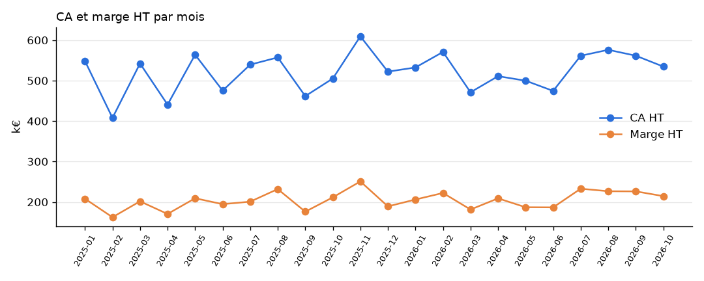
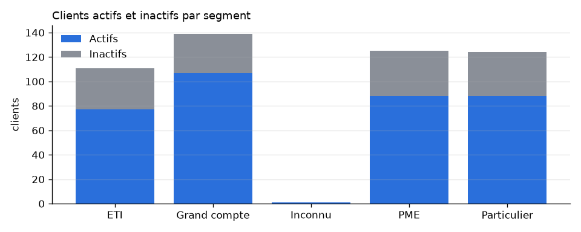

# Rapport d'analyse

Généré le 2026-11-23 23:35 par `scripts/report.py`, exécution `20261123_233535`. Période couverte : 01/01/2025 au 31/10/2026.

> **Données synthétiques.** Les fichiers sources sont générés avec des tirages uniformes : les tendances observées ne reflètent aucune réalité métier. Ce rapport valide la chaîne de traitement, pas une décision.

## Synthèse

- 4 947 ventes valides sur 5 025 lignes brutes, soit 11 467 761 € de CA HT et 4 499 534 € de marge HT (taux de marge 39,2 %).
- Meilleur mois : 2025-11 (609 487 € HT). Mois le plus faible : 2025-02 (407 903 € HT).
- Catégorie principale : Materiel (26,8 % du CA HT). Catégorie la plus petite : Support (1,2 %).
- 361 clients actifs sur 500 (72,2 %), avec un achat dans les 90 jours avant le 31/10/2026.
- 800 tickets support, dont 181 non résolus. Délai médian de résolution : 21,5 h.
- Taux d'erreur applicatif le plus élevé : version 3.2.0 (5,15 %). Le plus bas : version 3.1.0 (4,58 %).

## 1. Chiffre d'affaires et marge par mois

| mois | nb_ventes | nb_clients | ca_ht | marge_ht | taux_marge_pct |
|---|---|---|---|---|---|
| 2025-01 | 217 | 168 | 548 569 | 208 086 | 37,9 |
| 2025-02 | 208 | 169 | 407 903 | 162 359 | 39,8 |
| 2025-03 | 236 | 177 | 542 319 | 201 656 | 37,2 |
| 2025-04 | 243 | 185 | 440 642 | 170 414 | 38,7 |
| 2025-05 | 235 | 182 | 564 039 | 209 261 | 37,1 |
| 2025-06 | 209 | 165 | 475 302 | 194 630 | 40,9 |
| 2025-07 | 233 | 182 | 539 481 | 200 859 | 37,2 |
| 2025-08 | 241 | 193 | 557 314 | 231 909 | 41,6 |
| 2025-09 | 189 | 153 | 461 662 | 176 053 | 38,1 |
| 2025-10 | 225 | 173 | 505 217 | 211 508 | 41,9 |
| 2025-11 | 230 | 192 | 609 487 | 250 853 | 41,2 |
| 2025-12 | 235 | 194 | 522 171 | 189 122 | 36,2 |
| 2026-01 | 221 | 176 | 532 519 | 206 154 | 38,7 |
| 2026-02 | 220 | 174 | 570 835 | 222 294 | 38,9 |
| 2026-03 | 222 | 176 | 471 155 | 181 386 | 38,5 |
| 2026-04 | 208 | 156 | 510 966 | 209 002 | 40,9 |
| 2026-05 | 228 | 183 | 499 804 | 187 000 | 37,4 |
| 2026-06 | 207 | 165 | 474 545 | 186 728 | 39,3 |
| 2026-07 | 244 | 202 | 561 448 | 232 908 | 41,5 |
| 2026-08 | 246 | 193 | 576 129 | 226 595 | 39,3 |
| 2026-09 | 241 | 194 | 561 568 | 226 269 | 40,3 |
| 2026-10 | 209 | 169 | 534 685 | 214 487 | 40,1 |

_Source : `sql/analyses/01_ca_marge_mensuels.sql`_

## 2. Chiffre d'affaires par catégorie et canal

| categorie | canal | nb_ventes | ca_ht | marge_ht | taux_marge_pct | part_ca_pct |
|---|---|---|---|---|---|---|
| Materiel | web | 320 | 891 406 | 354 294 | 39,7 | 7,8 |
| Conseil | magasin | 260 | 760 800 | 342 164 | 45,0 | 6,6 |
| Conseil | telephone | 259 | 756 367 | 332 612 | 44,0 | 6,6 |
| Materiel | telephone | 258 | 737 270 | 297 869 | 40,4 | 6,4 |
| Conseil | partenaire | 250 | 731 522 | 333 399 | 45,6 | 6,4 |
| Materiel | partenaire | 269 | 729 352 | 302 598 | 41,5 | 6,4 |
| Materiel | magasin | 258 | 719 803 | 297 112 | 41,3 | 6,3 |
| Formation | partenaire | 275 | 717 340 | 225 498 | 31,4 | 6,3 |
| Logiciel | telephone | 364 | 710 040 | 291 181 | 41,0 | 6,2 |
| Formation | magasin | 270 | 709 657 | 220 462 | 31,1 | 6,2 |
| Formation | web | 291 | 707 382 | 216 765 | 30,6 | 6,2 |
| Logiciel | magasin | 332 | 678 057 | 269 623 | 39,8 | 5,9 |
| Logiciel | web | 343 | 648 723 | 280 640 | 43,3 | 5,7 |
| Conseil | web | 235 | 642 210 | 278 279 | 43,3 | 5,6 |
| Logiciel | partenaire | 350 | 611 064 | 254 250 | 41,6 | 5,3 |
| Formation | telephone | 247 | 573 421 | 156 081 | 27,2 | 5,0 |
| Support | telephone | 104 | 42 632 | 13 911 | 32,6 | 0,4 |
| Support | web | 82 | 39 626 | 13 452 | 33,9 | 0,3 |
| Support | partenaire | 94 | 35 064 | 10 897 | 31,1 | 0,3 |
| Support | magasin | 86 | 26 025 | 8 446 | 32,5 | 0,2 |

_Source : `sql/analyses/02_ca_par_categorie_canal.sql`_

## 3. Clients actifs par segment

Actif : au moins un achat dans les 90 jours précédant la dernière vente connue. Les doublons probables de clients sont exclus.

| segment | nb_clients | actifs | inactifs | sans_achat | taux_actifs_pct | ca_ht_moyen_par_acheteur |
|---|---|---|---|---|---|---|
| ETI | 111 | 77 | 34 | 0 | 69,4 | 24 614 |
| Grand compte | 139 | 107 | 32 | 0 | 77,0 | 22 267 |
| Inconnu | 1 | 1 | 0 | 0 | 100,0 | 33 048 |
| PME | 125 | 88 | 37 | 0 | 70,4 | 22 638 |
| Particulier | 124 | 88 | 36 | 0 | 71,0 | 22 192 |
| **Total** | 500 | 361 | 139 | 0 | 72,2 | 22 884 |

_Source : `sql/analyses/03_clients_actifs_segment.sql`_

## 4. Support : incidents et délai de résolution

Le délai n'est calculé que pour les tickets résolus ou fermés sans anomalie de dates.

| priorite | nb_tickets | non_resolus | avec_delai | delai_median_h | delai_moyen_h | delai_p90_h | satisfaction_moyenne | nb_notes |
|---|---|---|---|---|---|---|---|---|
| critique | 64 | 19 | 45 | 23,6 | 34,0 | 79,3 | 3,51 | 37 |
| haute | 177 | 35 | 141 | 22,2 | 29,3 | 68,2 | 3,59 | 115 |
| normale | 374 | 83 | 289 | 20,3 | 30,9 | 72,3 | 3,53 | 255 |
| basse | 180 | 43 | 136 | 21,6 | 29,7 | 69,4 | 3,41 | 111 |
| non_renseignee | 5 | 1 | 4 | 27,7 | 28,8 | 44,9 | 2,33 | 3 |
| **Total** | 800 | 181 | 615 | 21,5 | 30,5 | 71,9 | 3,51 | 521 |

_Source : `sql/analyses/04_support_resolution.sql`_

## 5. Usage produit et erreurs

| mois | utilisateurs_actifs | nb_evenements | nb_erreurs | taux_erreur_pct |
|---|---|---|---|---|
| 2025-01 | 403 | 930 | 38 | 4,09 |
| 2025-02 | 393 | 815 | 46 | 5,64 |
| 2025-03 | 418 | 935 | 41 | 4,39 |
| 2025-04 | 408 | 907 | 54 | 5,95 |
| 2025-05 | 412 | 933 | 44 | 4,72 |
| 2025-06 | 422 | 904 | 45 | 4,98 |
| 2025-07 | 401 | 888 | 46 | 5,18 |
| 2025-08 | 408 | 906 | 41 | 4,53 |
| 2025-09 | 406 | 920 | 40 | 4,35 |
| 2025-10 | 419 | 924 | 47 | 5,09 |
| 2025-11 | 405 | 862 | 39 | 4,52 |
| 2025-12 | 415 | 914 | 43 | 4,70 |
| 2026-01 | 413 | 935 | 50 | 5,35 |
| 2026-02 | 381 | 825 | 36 | 4,36 |
| 2026-03 | 411 | 923 | 38 | 4,12 |
| 2026-04 | 410 | 862 | 45 | 5,22 |
| 2026-05 | 416 | 940 | 46 | 4,89 |
| 2026-06 | 407 | 950 | 40 | 4,21 |
| 2026-07 | 415 | 929 | 40 | 4,31 |
| 2026-08 | 408 | 922 | 48 | 5,21 |
| 2026-09 | 392 | 891 | 55 | 6,17 |
| 2026-10 | 428 | 945 | 50 | 5,29 |

_Source : `sql/analyses/06_usage_mensuel.sql`_

| app_version | utilisateurs | nb_evenements | nb_erreurs | taux_erreur_pct | duree_requete_mediane_ms |
|---|---|---|---|---|---|
| 3.1.0 | 501 | 3 974 | 182 | 4,58 | 406 |
| 3.2.0 | 501 | 4 000 | 206 | 5,15 | 402 |
| 3.2.1 | 501 | 3 989 | 186 | 4,66 | 416 |
| 3.3.0 | 501 | 4 048 | 199 | 4,92 | 420 |
| 4.0.0 | 501 | 3 944 | 199 | 5,05 | 390 |
| inconnue | 5 | 5 | 0 | 0,00 | 69 |

_Source : `sql/analyses/05_usage_erreurs_version.sql`_

## 6. Qualité des données

Lignes isolées dans la table `rejets` (non comptées dans les analyses) :

| table | motif | lignes |
|---|---|---|
| raw_evenements | R1 user_id manquant | 30 |
| raw_evenements | R3 timestamp futur | 10 |
| raw_ventes | R1 vente_id en conflit | 10 |
| raw_ventes | R2 date manquante ou invalide | 11 |
| raw_ventes | R3 client inconnu | 15 |
| raw_ventes | R4 produit inconnu | 5 |
| raw_ventes | R5 devise non geree | 3 |
| raw_ventes | R6 quantite hors plage | 4 |
| raw_ventes | R7 montant negatif | 10 |

Lignes gardées mais signalées :

| signal | lignes |
|---|---|
| ventes : montant TTC recalculé (manquant) | 5 |
| clients : doublon probable (même email) | 1 |
| clients : email invalide ou vide | 8 |
| produits : coût supérieur au prix | 1 |
| évènements : horodatage converti depuis epoch | 10 |
| évènements : durée aberrante mise à vide | 3 |
| tickets : resolution_avant_ouverture | 4 |
| tickets : statut_incoherent | 3 |

_Sources : table `rejets`, colonnes de signalement des tables `staging_*`, règles détaillées dans `docs/transformations.md`_

## Méthode

1. `scripts/import_raw.py` charge les fichiers sources sans modification (tables `raw_*`).
2. `scripts/build.py` applique les règles de `sql/staging/` puis crée les vues de `sql/marts/`.
3. Ce rapport exécute les requêtes de `sql/analyses/` en lecture seule.

Volumes après nettoyage : 4 947 ventes, 501 clients, 40 produits, 19 960 évènements, 800 tickets.

Fichiers sources utilisés (empreinte SHA-256, 12 premiers caractères). Mêmes empreintes et mêmes fichiers SQL = mêmes chiffres :

| table | fichier | sha256 | lignes | import |
|---|---|---|---|---|
| raw_clients | clients.xlsx | 84e23a11eb9d | 502 | 20261123_233535 |
| raw_evenements | evenements.jsonl | 61e68801a67d | 20 050 | 20261123_233535 |
| raw_produits | produits.csv | f87efc3ce5b5 | 40 | 20261123_233535 |
| raw_tickets | tickets.parquet | 222c3ef859e9 | 803 | 20261123_233535 |
| raw_ventes | ventes.csv | 4f97d3dd6943 | 5 025 | 20261123_233535 |

## Limites

- Données synthétiques, distributions uniformes : aucune conclusion métier possible.
- Montants HT déduits du TTC avec une TVA supposée à 20 %.
- Ventes en USD exclues faute de taux de change.
- Horodatages epoch interprétés en UTC (décalage possible d'une à deux heures).
- Clients actifs mesurés sur les achats, pas sur l'usage de l'application.

## À valider avant diffusion

- [ ] Le total du CA HT correspond à une source de référence.
- [ ] Les règles de rejet conviennent au métier (notamment montants négatifs et vente_id en conflit).
- [ ] La définition de client actif (90 jours) est la bonne.
- [ ] Aucune donnée personnelle n'apparaît dans le rapport.
